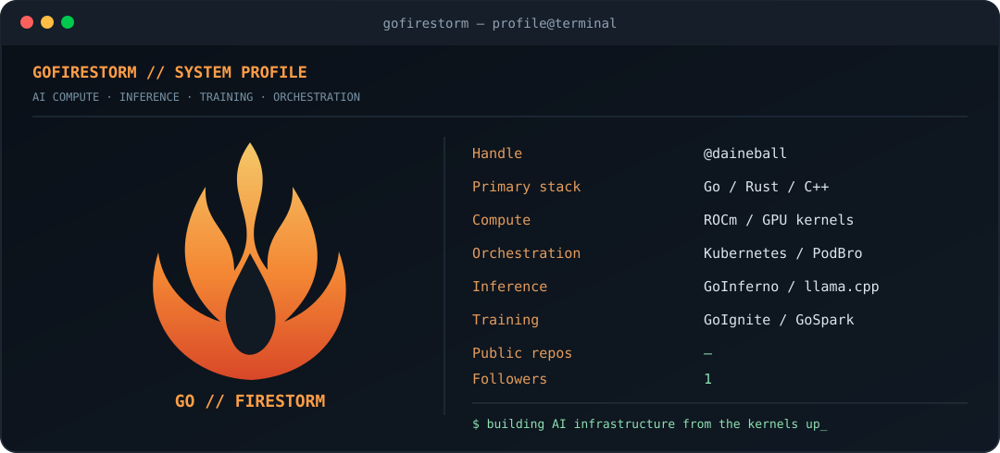

<div align="center">



# GoFirestorm · AI Infrastructure from the Kernels Up

**Go · Rust · C++ · GPU Compute · Inference · Training · Kubernetes**

Building practical AI systems from low-level kernels to managed model-serving infrastructure.

[](https://github.com/daineball?tab=followers)
[](https://github.com/daineball)

</div>

## `$ whoami`

I'm a systems-focused developer working on GPU acceleration, model inference, training pipelines, and orchestration. I like understanding the entire stack — from memory movement and kernels to model lifecycle and deployment.

## `$ tree gofirestorm/`

```text
GoFirestorm/
├── GoSpark      GPU kernels, tensor operations, execution
├── GoIgnite     Training and experiment pipelines
├── GoBlaze      Deployment, orchestration, runtime health
│   └── PodBro   GPU-aware model lifecycle coordination
└── GoInferno    Model loading, inference, and serving

Harold/         Personal AI research and integration
Argus/          Observability and telemetry
```

## `$ cat engineering-focus.txt`

| Area | What I'm building and exploring |
| --- | --- |
| GPU compute | AMD ROCm, kernel optimization, quantized model execution |
| Model serving | GGUF workflows, llama.cpp integration, model lifecycle management |
| Distributed systems | Kubernetes, services, scheduling, observability |
| AI research | Inference efficiency, training infrastructure, experimental architectures |
| Languages | Go, Rust, C++, Python, shell |

## `$ git status --short`

**Current interests:** reliable GPU inference, reproducible benchmarks, efficient memory residency, and making serious compute available to more than one development machine.

> **Build it. Measure it. Verify it. Improve it.**

---

<div align="center">

*GoFirestorm // Keep the compute honest.* 🔥

</div>
